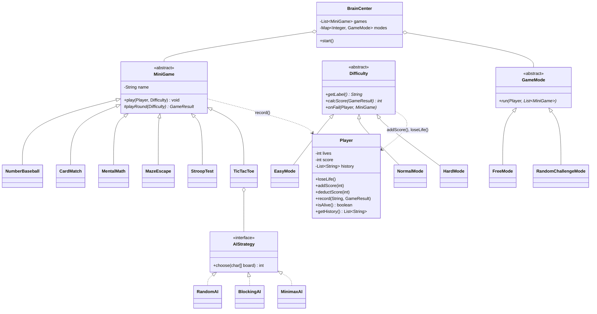

# 🧠 브레인 오버라이드 (Brain Override)

> 굳은 두뇌를 **오버라이드**하라.
> 누구나 아는 두뇌게임 6종을 플레이하고, 결과로 **"두뇌 나이"**를 받는 콘솔 미니게임 모음집입니다.

**팀 삼두엽** (심소민 · 정종일 · 나혜빈) · 발표 2026-10-19(월)

---

## 목차

1. [프로젝트 개요](#1-프로젝트-개요)
2. [실행 방법](#2-실행-방법)
3. [게임 진행 흐름](#3-게임-진행-흐름)
4. [미니게임 6종](#4-미니게임-6종)
5. [점수, 목숨, 두뇌 나이](#5-점수-목숨-두뇌-나이)
6. [클래스 설계와 OOP 4개념](#6-클래스-설계와-oop-4개념)
7. [디렉터리 구조](#7-디렉터리-구조)
8. [팀 구성과 역할](#8-팀-구성과-역할)
9. [개발 일정](#9-개발-일정)
10. [협업 규칙](#10-협업-규칙)

---

## 1. 프로젝트 개요

| 항목 | 내용 |
| --- | --- |
| 장르 | 콘솔 기반 두뇌 트레이닝 미니게임 모음 |
| 언어 | Java 17 이상 (외부 라이브러리 없이 JDK만 사용) |
| 인원 / 기간 | 3명 / 3일 |
| 목표 | 추상화, 상속, 캡슐화, 다형성 4개념을 모두 근거 있게 적용 |
| 승리 조건 | 목숨 3개를 지키며 게임을 마치고, 두뇌 나이 20세에 가깝게 받기 |
| 패배 조건 | 목숨 0개가 되면 즉시 게임 오버 |

### 차별점

- **6개 게임이 서로 다른 두뇌 영역을 측정합니다.** 영역이 겹치지 않아서 "두뇌 나이"가 한 능력에 치우치지 않습니다.
- **다형성 축이 4개입니다.** 미니게임, 난이도, 게임 모드, 삼목 AI 전략. 각 축의 자식 클래스는 숫자가 아니라 **동작**이 다릅니다.
- **추상 클래스와 인터페이스를 목적에 맞게 나눠 썼습니다.** 공통 코드가 있는 `MiniGame`은 추상 클래스, 약속만 있는 `AIStrategy`는 인터페이스입니다.
- **Hard 난이도는 수치가 아니라 규칙이 바뀝니다.** 예: 숫자야구는 힌트 1회가 거짓, 미로 탈출은 좌우 조작이 반전됩니다.

---

## 2. 실행 방법

### IntelliJ IDEA (권장)

1. `File → Open`으로 저장소 폴더를 엽니다.
2. `src` 폴더 우클릭 → `Mark Directory as → Sources Root`
3. `src/Main.java`의 ▶ 버튼으로 실행합니다.

### 터미널

```bash
# macOS / Linux
javac -encoding UTF-8 -d out $(find src -name "*.java")
java -cp out Main

# Windows PowerShell
chcp 65001
javac -encoding UTF-8 -d out (Get-ChildItem -Recurse src -Filter *.java).FullName
java -Dstdout.encoding=UTF-8 -cp out Main
```

- **Windows 한글 깨짐**: `chcp 65001`과 `-Dstdout.encoding=UTF-8`은 콘솔을 UTF-8로 맞추는 설정입니다. 이게 없으면 한글이 `???`로 나옵니다.
- **스트룹 색상**: ANSI 색상을 사용합니다. Windows Terminal, VS Code 터미널, IntelliJ 콘솔에서는 정상이고, 구버전 `cmd.exe`에서는 깨질 수 있습니다.
- **카드 뒤집기 화면 지우기**: IntelliJ Run 콘솔은 화면 지우기를 지원하지 않아 빈 줄로 밀어내는 방식으로 대체됩니다. 실제 터미널에서 실행하면 깔끔하게 지워집니다.

---

## 3. 게임 진행 흐름

```
시작 → 이름 입력 → 모드 선택 ─┬─ 자유 모드: 게임 1개 + 난이도 선택 → 플레이 → 메뉴 복귀
                              ├─ 랜덤 챌린지: 6개 중 3개 랜덤 연속 출제 → 결과 화면
                              └─ 종료 → 결과 화면

플레이 중 목숨 0개 → 즉시 게임 오버 화면
```

1. 시작 화면에서 플레이어 이름을 입력합니다. 목숨 3개, 점수 0점으로 시작합니다.
2. 게임 모드를 선택합니다.
   - **자유 모드**: 미니게임 1개와 난이도를 직접 고릅니다. 끝나면 메뉴로 돌아옵니다.
   - **랜덤 챌린지**: 6개 중 3개가 중복 없이 랜덤 순서로 연속 출제됩니다. 난이도는 시작할 때 한 번 고릅니다.
3. 성공하면 난이도 정책에 따라 점수를 받고, 실패하면 패널티를 받습니다.
4. 종료하거나 챌린지를 완주하면 게임별 결과, 총점, 두뇌 나이를 출력합니다.

---

## 4. 미니게임 6종

| # | 미니게임 | 두뇌 영역 | 클래스 | 담당 | 설명서 |
| --- | --- | --- | --- | --- | --- |
| 1 | ⚾ 숫자야구 | 논리 추론 | `NumberBaseball` | 나혜빈 | [number_baseball.md](docs/games/number_baseball.md) |
| 2 | 🃏 카드 뒤집기 | 기억력 | `CardMatch` | 심소민 | [card_match.md](docs/games/card_match.md) |
| 3 | ➕ 암산 스피드 | 계산 · 처리 속도 | `MentalMath` | 정종일 | [mental_math.md](docs/games/mental_math.md) |
| 4 | 🧭 미로 탈출 | 공간 지각 | `MazeEscape` | 나혜빈 | [maze_escape.md](docs/games/maze_escape.md) |
| 5 | 🎨 스트룹 | 주의 · 억제 | `StroopTest` | 심소민 | [stroop_test.md](docs/games/stroop_test.md) |
| 6 | ⭕ 삼목 대결 | 전략 | `TicTacToe` | 정종일 | [tic_tac_toe.md](docs/games/tic_tac_toe.md) |

### 난이도별 규칙 요약

| 미니게임 | Easy | Normal | Hard (규칙 변화) |
| --- | --- | --- | --- |
| 숫자야구 | 3자리, 10회 | 4자리, 10회 | 4자리, 8회 + 힌트 중 1회는 거짓 |
| 카드 뒤집기 | 4×2(4쌍), 12회 | 4×4(8쌍), 20회 | 4×4, 20회 + 3회 연속 실패 시 남은 카드 섞임 |
| 암산 스피드 | 덧셈, 뺄셈 | 곱셈 추가 | 3문제마다 연산자 의미 반전 |
| 미로 탈출 | 5×5 미로 | 9×9 미로 | 9×9 + 좌우 반전 조작 |
| 스트룹 | 의미와 색 일치 비율 높음 | 의미와 색 불일치 | 문제마다 "글자를 읽어라 / 색을 말해라" 지시 전환 |
| 삼목 대결 | RandomAI, 승리 시 성공 | BlockingAI, 승리 시 성공 | MinimaxAI, 무승부 이상 성공 |

### 공통 규칙

- 모든 미니게임은 한 판의 결과로 `GameResult`(성공 여부, 기본 점수, 소요 시간, 기준 시간)를 반환합니다.
- 기본 점수는 게임마다 100점이고, 최종 점수는 난이도 정책이 계산합니다.
- 입력 형식이 틀리면(숫자 자리에 문자 등) **기회를 차감하지 않고** 재입력을 요청합니다.

---

## 5. 점수, 목숨, 두뇌 나이

난이도는 "얼마나 어렵나"뿐 아니라 **"성공과 실패를 어떻게 판정하나"**를 바꿉니다.

| 난이도 | 클래스 | 성공 시 점수 | 실패 시 처리 | 1판 최대 점수 |
| --- | --- | --- | --- | --- |
| Easy | `EasyMode` | 100점 | 같은 게임 재도전 1회, 재도전도 실패하면 목숨 -1 | 100점 |
| Normal | `NormalMode` | 100 × 1.5 + 시간 보너스(최대 50) | 목숨 -1 | 200점 |
| Hard | `HardMode` | 100 × 2 + 시간 보너스 × 2(최대 100) | 목숨 -1, 점수 -50 (0점 미만 불가) | 300점 |

- **시간 보너스** = 50 × (1 − 소요 시간 ÷ 기준 시간), 0점 미만은 0점
- **두뇌 나이** = 60 − 40 × (총점 ÷ 만점). 만점은 플레이한 각 게임의 난이도별 최대 점수 합입니다. 결과는 20세(만점) ~ 60세(0점)입니다.

### 출력 예시

```
=== 랜덤 챌린지 2/3 : 스트룹 테스트 (Hard) ===
지시: 색을 말해라 → [파랑으로 칠해진 "빨강"]
입력: 4
정답! +246점 (남은 목숨 3)

=== 최종 결과 ===
숫자야구 성공 271점 | 스트룹 성공 246점 | 암산 실패 -50점
총점 467 / 만점 900 → 두뇌 나이 39세
```

---

## 6. 클래스 설계와 OOP 4개념



| 개념 | 적용 클래스 | 구현 | 왜 여기인가 |
| --- | --- | --- | --- |
| **추상화** | `MiniGame`, `Difficulty`, `GameMode` (추상 클래스), `AIStrategy` (인터페이스) | `playRound()`, `calcScore()`, `onFail()`, `run()`, `choose()`를 abstract로 선언 | 호출하는 쪽은 "무엇을 하는지"만 알고 "어떻게"는 몰라도 되게 하기 위해 |
| **상속** | 자식 14개 | `play()`의 공통 흐름(안내 → 라운드 → 점수 적용 → 기록)을 부모에 한 번만 작성하고 `final`로 고정 | 6개 게임이 같은 흐름 코드를 반복하지 않고, 자식이 흐름을 실수로 바꾸지 못하게 |
| **캡슐화** | `Player` | 목숨, 점수, 기록을 `private`으로 두고 메서드로만 변경. `getHistory()`는 복사본 반환 | 목숨 음수, 점수 직접 조작 같은 잘못된 상태를 한 곳에서 차단 |
| **다형성** | `BrainCenter`, `GameMode`, `TicTacToe` | `List<MiniGame>`에 자식 6개를 담고 `game.play()` 호출 | 게임·난이도·모드·AI가 늘어도 호출 코드를 수정하지 않도록 |

### 추상 클래스 vs 인터페이스: 왜 나눴나

| | `MiniGame` (abstract class) | `AIStrategy` (interface) |
| --- | --- | --- |
| 공통 코드 | 있음: `play()`의 진행 흐름, `name` 필드 | 없음: `choose()` 약속만 |
| 자식이 물려받는 것 | 코드 + 약속 | 약속만 |
| 선택 이유 | 6개 게임이 같은 흐름을 **공유**해야 함 | AI마다 알고리즘이 완전히 달라 공유할 코드가 없음 |

### 다형성으로 사라지는 if 분기

| 위치 | 다형성이 없으면 | 적용 후 |
| --- | --- | --- |
| 모드 선택 | 모드 번호별 if 2갈래 | `modes.get(choice).run(player, games)` |
| 게임 실행 | 게임 이름별 if 6갈래 | `game.play(player, difficulty)` |
| 점수 · 패널티 | 난이도 3갈래 × 성공/실패 2갈래 | `difficulty.calcScore(result)`, `difficulty.onFail(player, this)` |
| 삼목 AI | 난이도별 if 3갈래 | `ai.choose(board)` |
| **게임 1개 추가 시 수정 지점** | 위 모든 곳 | **0곳** (새 클래스 작성 + `GameRegistry`에 1줄) |

### Day 1에 확정할 인터페이스

아래는 **시그니처만** 정한 뼈대입니다. 메서드 내용은 담당자가 채웁니다.

```java
// core/MiniGame.java
public abstract class MiniGame {
    private final String name;

    protected MiniGame(String name) { this.name = name; }
    public String getName() { return name; }

    // 템플릿 메서드: 모든 게임의 공통 흐름. final이라 자식이 바꿀 수 없음
    public final void play(Player player, Difficulty difficulty) {
        // 1. 게임 이름과 난이도 안내 출력
        // 2. playRound(difficulty) 호출 → GameResult 받기
        // 3. 성공이면 player.addScore(difficulty.calcScore(result))
        //    실패면 difficulty.onFail(player, this)
        // 4. player.record(name, result)
    }

    // 게임마다 다른 부분: 자식이 반드시 구현
    protected abstract GameResult playRound(Difficulty difficulty);
}
```

```java
// core/Difficulty.java
public abstract class Difficulty {
    public abstract String getLabel();                         // "Easy" / "Normal" / "Hard"
    public abstract int calcScore(GameResult result);
    public abstract void onFail(Player player, MiniGame game);  // EasyMode는 여기서 game.playRound(this)로 재도전
}
```

> **`Difficulty`가 `protected`인 `playRound()`를 부를 수 있는 이유**: Java의 `protected`는 자식 클래스뿐 아니라 **같은 패키지**의 클래스도 접근할 수 있습니다. `MiniGame`과 `Difficulty`가 둘 다 `core` 패키지에 있어서 가능합니다.

### 남는 한계 (발표 때 먼저 밝힐 것)

각 미니게임 안에서 난이도별 자릿수 · 제한 횟수를 고르는 부분은 레벨 값에 따른 선택이 남습니다. 이것은 동작 분기가 아니라 **설정값 조회**이므로, if 대신 레벨을 키로 하는 `Map`으로 처리합니다.

```java
private static final Map<String, Integer> DIGITS = Map.of("Easy", 3, "Normal", 4, "Hard", 4);
int digits = DIGITS.get(difficulty.getLabel());
```

---

## 7. 디렉터리 구조

```
brain-override/
├── src/
│   ├── Main.java                     # 진입점: new BrainCenter().start()
│   │
│   ├── core/                         # 🔒 공통 뼈대 (Day 1 오전 확정, 이후 변경은 전원 합의)
│   │   ├── MiniGame.java             # 추상 클래스
│   │   ├── GameResult.java           # 한 판의 결과
│   │   ├── ConsoleUtil.java          # 입력 검증, 화면 지우기, ANSI 색상, 대기
│   │   ├── Player.java               # 캡슐화
│   │   ├── Difficulty.java           # 추상 클래스
│   │   ├── EasyMode.java
│   │   ├── NormalMode.java
│   │   └── HardMode.java
│   │
│   ├── games/                        # 🎮 구체 미니게임 (각자 작업)
│   │   ├── GameRegistry.java         # 게임 목록 (게임 추가 시 1줄)
│   │   ├── NumberBaseball.java
│   │   ├── CardMatch.java
│   │   ├── MentalMath.java
│   │   ├── MazeEscape.java
│   │   ├── MazeData.java             # 미로 데이터 (로직과 분리)
│   │   ├── StroopTest.java
│   │   └── tictactoe/
│   │       ├── TicTacToe.java
│   │       ├── AIStrategy.java       # 인터페이스
│   │       ├── RandomAI.java
│   │       ├── BlockingAI.java
│   │       ├── MinimaxAI.java
│   │       └── BoardUtil.java        # 승리 판정, 빈칸 찾기
│   │
│   └── app/                          # 🧩 조립과 진행
│       ├── GameMode.java             # 추상 클래스
│       ├── FreeMode.java
│       ├── RandomChallengeMode.java
│       └── BrainCenter.java          # 메인 메뉴
│
├── docs/games/                       # 게임별 설명서 6개
├── .github/pull_request_template.md
├── CONTRIBUTING.md                   # 협업 가이드
└── .gitignore
```

- **규칙**: 추상 클래스와 공통 데이터는 `core`, 구체 게임은 `games`, 조립과 진행은 `app`
- **의존 방향**: `app → games → core`. `core`는 다른 패키지를 import하지 않습니다.
- 구체 게임 클래스 이름은 `GameRegistry` 한 곳에만 등장합니다. 그래서 게임을 추가해도 메뉴 코드는 바뀌지 않습니다.

자세한 이유는 [CONTRIBUTING.md](CONTRIBUTING.md) 1절을 보세요.

---

## 8. 팀 구성과 역할

구현 난도를 점수로 매겨(하 = 1, 중 = 2, 중상 = 3) 미니게임 부담이 비슷하게 나뉘도록 배정했습니다. 미니게임 부담이 가장 작은 사람이 통합 작업(BrainCenter)을 맡습니다.

| 담당 | 미니게임 | 미니게임 난도 합 | 공통 클래스 | 그 외 |
| --- | --- | --- | --- | --- |
| **심소민** | 스트룹(2), 카드 뒤집기(2) | 4 | `MiniGame`, `GameResult`, `ConsoleUtil` | GitHub 저장소 생성, 브랜치 보호 설정 |
| **정종일** | 삼목 대결(3), 암산 스피드(1) | 4 | `Player`, `Difficulty` 계층 | 점수 계산 검증 |
| **나혜빈** | 숫자야구(1.5), 미로 탈출(1.5) | 3 | `GameMode` 계층, `BrainCenter`, `GameRegistry` | README 최종 정리, 발표 자료 |

- 스트룹과 카드 뒤집기는 둘 다 콘솔 출력(ANSI 색상, 화면 지우기)을 다루므로, 같은 사람이 `ConsoleUtil`까지 맡으면 중복 구현이 없습니다.
- 삼목은 `AIStrategy` 계층까지 포함해 난도가 가장 높아서, 가벼운 암산 스피드와 짝지었습니다.

---

## 9. 개발 일정

| 일차 | 오전 | 오후 |
| --- | --- | --- |
| Day 1 | 전원: `core` 인터페이스 확정 (클래스 이름, 메서드 이름, 매개변수, 반환 타입) | 공통 클래스 구현, 미니게임 1개씩 착수 |
| Day 2 | 미니게임 각자 완성 | `BrainCenter` 연결, 1차 통합 플레이 |
| Day 3 | 버그 수정, 점수 밸런스 조정 | README 정리, `dev` → `main` 최종 머지, 발표 리허설 |

- [ ] `core` 인터페이스 확정 (Day 1 오전)
- [ ] 콘솔 환경 확인: Windows 한글 출력, ANSI 색상, 화면 지우기 (Day 1 오전)
- [ ] 저장소를 처음부터 Public으로 생성하고 `main`, `dev` 브랜치 보호 설정 (Day 1 오전)
- [ ] 팀 페이지에 요구사항 문서와 저장소 링크 등록 (Day 3)

---

## 10. 협업 규칙

브랜치, 커밋, PR · 머지 규칙, 코드 리뷰, 충돌 해결은 **[CONTRIBUTING.md](CONTRIBUTING.md)**에 단계별로 정리했습니다.

| 항목 | 규칙 |
| --- | --- |
| 브랜치 | `main`(완성본) ← `dev`(통합) ← `feat/<기능>` (예: `feat/card-match`) |
| 직접 푸시 | `main`, `dev`는 금지. 브랜치 보호로 막아둠 |
| 커밋 메시지 | `feat: 카드 뒤집기 Hard 섞기 구현` (`feat` / `fix` / `refactor` / `docs` / `test` / `chore`) |
| 머지 조건 | PR + 승인 1명 이상. `core/` 변경은 나머지 2명 모두 승인 |
| 머지 방식 | Squash and merge, 머지 버튼은 PR 작성자가 누름 |
| 단독 실행 | 각 게임 클래스의 테스트용 `main()`을 IntelliJ ▶ 버튼으로 실행 |
